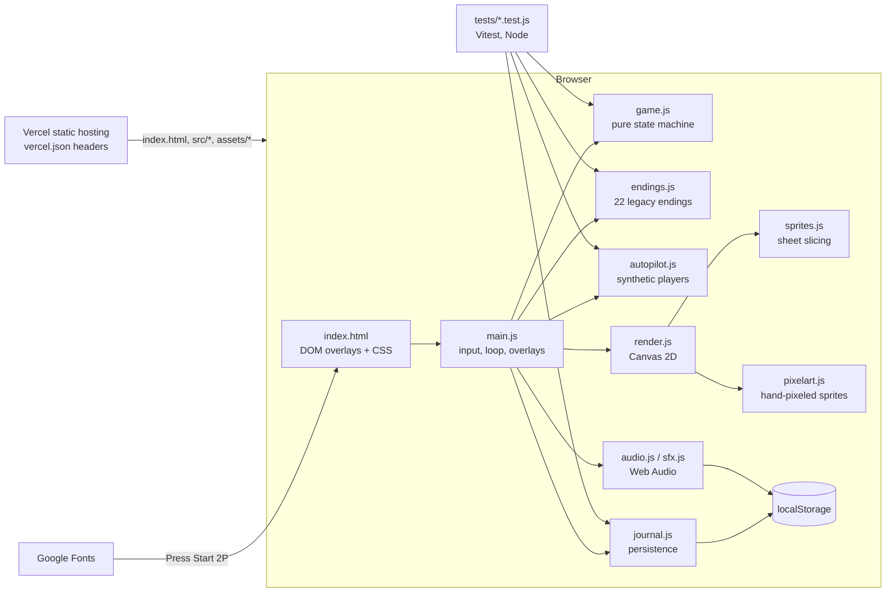

# Almost There: Architecture

Status: v6 (2026-10). Written from the code. Gameplay rules: [GAME-DESIGN.md](GAME-DESIGN.md).

## 1. Overview

A static single-page game. One HTML file loads one ES module (`src/main.js`), which imports the rest. There is no
bundler, no framework, no server code and no runtime dependency. Vitest is the only dev dependency.

## 2. Components

| Module | Responsibility | DOM / browser APIs |
| --- | --- | --- |
| `src/game.js` | Constants, `HAZARD_TYPES`, seeded RNG (`mulberry32`), `generateCourse`, `createState`, `startRun`, `step(state, input, dt)`, collisions, camera, effects. | None (pure, runs in Node) |
| `src/autopilot.js` | `perfectInput` (flawless player) and `createHumanInput` (jittery player) used by tests and `?autopilot=1`. | None |
| `src/endings.js` | `ENDINGS`, `pickEnding` (no repeats until all seen), `getEnding`. Only used with `?endings=1`. | None in logic; endings call `s.ui.*` hooks |
| `src/journal.js` | Load/save the run log with validation; injectable storage. | `localStorage` (optional) |
| `src/main.js` | Boot, URL params, input (keyboard, pointer), fixed-cap frame loop (`dt ≤ 50 ms`), DOM overlays, journal panel, debug hook. | DOM, `requestAnimationFrame`, `location.search` |
| `src/render.js` | Draws world, hazards, hero, cake, table, HUD, overlays on a 960×540 canvas. | Canvas 2D |
| `src/sprites.js` / `src/pixelart.js` | Load Kenney sheets from `assets/sprites/`; hand-pixeled sprites from string grids. | `Image` |
| `src/audio.js` / `src/sfx.js` | Fetch and decode `assets/audio/*.ogg`, music loop, mute toggle. | Web Audio, `fetch` (same origin), `localStorage` |

## 3. Data flow

1. `boot()` loads sprite sheets and the font, builds the renderer, shows the title.
2. Input sets `input.jumpPressed / jumpHeld`; each frame `tick(dt)` calls `step(state, input, dt)`.
3. `step` advances the simulation and pushes events (`state.events`) that `main.js` turns into sound, overlays and
   journal updates (`recordRun`, `markSeen`, then `saveJournal`).
4. `render.draw(state, hud)` paints the frame.

`state.reducedMotion` is copied from `matchMedia('(prefers-reduced-motion: reduce)')` at the start of every tick.
`blackoutLevel` (pure, tested in `tests/motion.test.js`) then returns a smooth ramp to `CALM_DIM` instead of a
flicker to 1, and the renderer skips camera shake. Physics never read the flag.

Phases: `TITLE → RUNNING → DEAD | WIN`; with `?endings=1`, `RUNNING → ENDING → LOST`.

## 4. Data model

Only client-side `localStorage`; nothing is sent anywhere.

| Key | Shape | Validation on load |
| --- | --- | --- |
| `almost-there:v2` | `{ seen: string[], attempts, best, wins, bestM: number, deaths: { [hazardType]: number } }` | Non-object → empty journal; arrays filtered to strings; numbers must be finite; `best ≤ 99.9`, `bestM ≤ 100`; parse errors → empty journal. |
| `almost-there:mute` | `'1'` or `'0'` | Anything but `'1'` → unmuted. |

Run-log cards are built with `textContent`, so stored strings are never parsed as HTML.

## 5. External services

- **Vercel**: static hosting, auto-deploy on push to `main`. No functions, no env vars at runtime.
- **Google Fonts**: stylesheet from `fonts.googleapis.com`, font file from `fonts.gstatic.com`. Falls back to a
  monospace font if blocked.
- No analytics, no APIs, no auth. There are no user accounts (auth model: none, by design).

## 6. Runtime, deployment, config

- Local: `npm run dev` (static server on port 5300, `serve.json` disables caching). `file://` does not work (ES modules).
- Deploy: push to `main` → Vercel builds nothing and serves the folder. `vercel.json` sets security headers and caching
  (`no-cache` for the page and `src/`, one day for `assets/`). `index.html` loads `src/main.js?v=6`; bump it when
  module caching matters.
- CI: `.github/workflows/ci.yml` runs `npm ci && npm test` on Node 22 with a read-only token.
- Config: query parameters only (README "Dev query params"). No environment variables are read by the app.

## 7. Security boundaries

- Untrusted inputs: URL query parameters and `localStorage` contents (another script on the same origin, or a user
  editing storage). Both are parsed defensively: `?course` drops unknown hazard types and non-finite positions,
  `?advance` is finite-checked and capped at 600 s, `?ending` is looked up by id, `?seed` is coerced to uint32.
- No `eval`, no inline scripts, no `innerHTML` with dynamic data except static ending titles/captions from source.
- Headers (`vercel.json`): CSP (`script-src 'self'`, Google Fonts allowed, `frame-ancestors 'none'`), `X-Frame-Options:
  DENY`, `nosniff`, `Referrer-Policy`, `Permissions-Policy`. `style-src` keeps `'unsafe-inline'` for the inline
  `<style>` block.
- `?debug` exposes `window.__almost` (state, restart, autopilot). It only affects the visitor's own tab.

## 8. Known tech debt

- `main.js` (~500 lines) and `game.js` (~1 100 lines) mix several concerns; fine for the size, but `stepHazards` is long.
- Rendering and DOM wiring have no automated tests; they rely on headless screenshots done by hand.
- The copy embedded in the landing page repo is maintained by hand and drifts.
- Legacy endings mode (`?endings=1`) is kept alive but unused by default.
